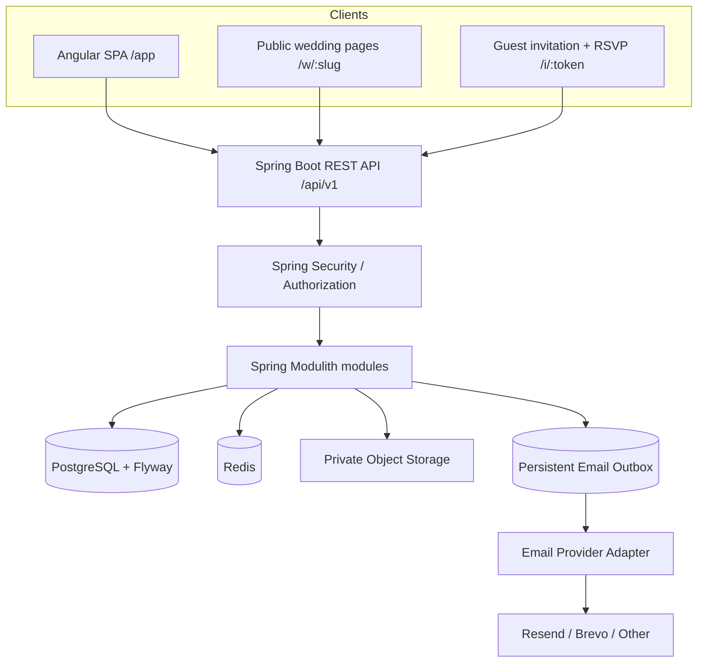
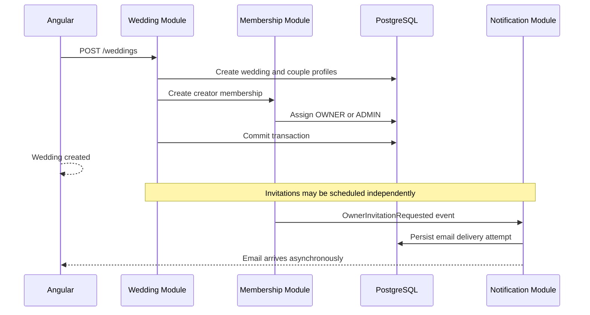
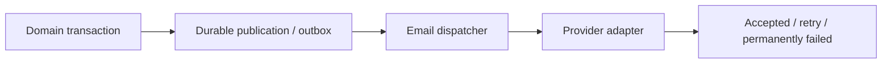

# Make My Marriage — System Design & Architecture

**Status:** MVP architecture baseline  
**Version:** 1.0  
**Last consolidated:** 2026-10-10  
**Architectural style:** Spring Boot modular monolith, enforced by Spring Modulith  
**Frontend:** Angular single-page application  
**API:** Versioned REST (`/api/v1`)  
**Data:** PostgreSQL + Flyway; Redis from day one

> This Markdown edition consolidates the agreed architecture. Items marked **Deferred** or **Open** are not implementation commitments.

## 1. Architectural goals

Make My Marriage (MMM) is a collaborative wedding-planning SaaS for couples and trusted organizers. Its early usage expectations are relatively modest: thousands of wedding workspaces, potentially hundreds of guests per wedding. The architecture should optimize for security, clear domain boundaries, shipping an MVP, and learning good engineering practices rather than premature horizontal scale.

**Goals:**

1. Single deployable backend with strong, testable internal module boundaries.
2. Predictable API contract for a single responsive Angular SPA.
3. PostgreSQL as source of truth, with tenant isolation by wedding.
4. Secure couple ownership and fine-grained permissions.
5. Reliable email, guest RSVP and files without requiring guest accounts.
6. Docker-based local development, CI tests and cloud portability.
7. An upgrade path for more sophisticated observability, background workers and Kubernetes.

**Non-goals:** microservices, event streaming cluster, Elasticsearch, real-time subscriptions, AI, subscription billing, vendor marketplace and custom native apps in the MVP.

## 2. High-level architecture



All planner functionality, guest link exchanges, and public read endpoints share the same backend deployment, but have distinct security policies and response DTOs.

## 3. Technology decisions

| Concern | MVP choice | Notes |
|---|---|---|
| Web | Angular + TypeScript | One SPA, planner and guest/public routes |
| Frontend state | Angular Signals/RxJS | Feature-level stores/services, avoid global state overengineering |
| API | REST + OpenAPI | Versioned `/api/v1`, contract-first or generated/verified specification |
| Backend | Java + Spring Boot | Latest compatible supported versions selected at project setup |
| Architecture | Modular Monolith | Spring Modulith verifies dependencies and integration behavior |
| Auth | Spring Security | Short-lived access JWT + rotating HttpOnly refresh-cookie session initially proposed |
| Primary DB | PostgreSQL | Relational data, joins, FTS/trigram for search |
| Migrations | Flyway | Mandatory, versioned, immutable once shared |
| Persistence | Spring Data JPA/Hibernate | `ddl-auto=validate`; explicit projections for reports |
| Cache/session/rate limit | Redis | Required from day one, locally in Docker |
| Files | Private object storage | Azure Blob/S3-compatible provider via abstraction; signed upload/download |
| Email | Provider adapter | Mailpit locally; free-tier provider choice can change |
| Background work | Spring application/Modulith events + durable outbox | No Kafka/RabbitMQ initially |
| Local development | Docker Compose | PostgreSQL, Redis, Mailpit (+ optional storage emulator) |
| CI/CD | GitHub Actions | Test, lint, build images and eventually deploy |
| Telemetry (MVP) | Actuator, Micrometer, structured logs | Correlation IDs, metrics/health |
| Telemetry (later) | OpenTelemetry, Prometheus, Grafana | Not required for initial setup |
| Cloud | Deferred | Azure Container Apps or AKS/Kubernetes under consideration |

Do not treat an Azure subscription's available regions/SKUs as guaranteed before deployment. **Central India** is a candidate region to investigate when choosing the hosting setup.

## 4. Modular monolith architecture

### Module boundaries

Suggested business modules:

```text
identity
wedding
membership
event
task
guest
invitation
rsvp
finance
vendor
document
gift
seating
website
media
notification
audit
```

Each module owns its application services, domain model, persistence and public interfaces. Other modules interact through explicit APIs or published domain events; they should not reach directly into another module's repositories/JPA internals.

Example layout:

```text
backend/src/main/java/com/makemymarriage/
├── MakeMyMarriageApplication.java
├── shared/                  # tightly controlled infrastructure primitives
├── identity/
│   ├── api/                 # HTTP controllers + request/response DTOs
│   ├── application/         # use cases and transactions
│   ├── domain/              # invariants and domain services
│   └── infrastructure/      # JPA, providers, adapters
├── wedding/
├── membership/
├── event/
├── task/
├── guest/
├── invitation/
├── rsvp/
├── finance/
├── vendor/
├── document/
├── gift/
├── seating/
├── website/
├── media/
├── notification/
└── audit/
```

The module API should be small and stable. Public interfaces may include use-case services and immutable data records; implementation packages should be inaccessible outside their module where practicable.

### Spring Modulith

- Declare modules with explicit allowed dependencies.
- Run `ApplicationModules.of(...).verify()` as a test.
- Use application events for side effects that are logically downstream of a successful transaction.
- For critical notifications, use a **persistent event publication/outbox mechanism** with retry and idempotent consumers.
- Never rely on an in-memory `@Async` event alone to guarantee email delivery after a process crash.

Example business interaction:



Keep application transactions bounded to local database operations. Avoid HTTP/email/cloud-storage side effects within an open DB transaction.

## 5. Wedding tenancy and ownership

### Tenancy

- One shared PostgreSQL database and schema.
- `wedding_id` on wedding-scoped aggregate records; indexed for frequent queries.
- All queries should constrain by `wedding_id` and active membership/required permission.
- Foreign keys should prevent relationships to a different wedding, preferably with composite unique keys and composite FKs in sensitive associations.
- Public website/RSVP endpoints intentionally use distinct authorization predicates, not a generic bypass of membership checks.

### Ownership model

```text
Wedding
  ├── created_by_user_id      # who created the workspace; not ownership
  ├── CoupleProfile(BRIDE)    # can exist without account
  ├── CoupleProfile(GROOM)    # can exist without account
  └── WeddingMembers
       ├── OWNER / BRIDE
       ├── OWNER / GROOM
       ├── ADMIN...
       ├── FAMILY_MEMBER...
       └── COLLABORATOR...
```

A creator who selects BRIDE or GROOM becomes an owner in that role. A creator selecting FAMILY_MEMBER or FRIEND becomes setup ADMIN; they can arrange work and invite owners but cannot impersonate them.

Secure membership invitation acceptance links the verified intended account to the vacant couple-owner position in one transaction. The database enforces uniqueness; the application enforces legitimate claim, invite validation, no unauthorized owner demotion, and recovery policies.

### RBAC + explicit permissions

Role grants plus member-specific ALLOW/DENY overrides, with owner-protected capabilities. Examples:

- `MANAGE_EVENTS`, `MANAGE_TASKS`, `VIEW_GUESTS`, `MANAGE_GUESTS`
- `VIEW_FINANCE`, `MANAGE_FINANCE`
- `MANAGE_VENDORS`, `MANAGE_INVITATIONS`, `MANAGE_SEATING`
- `MANAGE_GIFTS`, `MANAGE_DOCUMENTS`, `MANAGE_WEBSITE`, `MANAGE_MEMBERS`

The frontend may hide unavailable features, but every endpoint verifies authorization independently. Private tasks require resource-level access checks beyond module permissions.

## 6. Authentication and account security

### Initial authentication approach

- Email/password with modern adaptive password hashing, account verification and password reset.
- Access JWT is short-lived (initial example: 15 minutes), kept in Angular memory rather than localStorage.
- Refresh credential is opaque, rotated on every use and issued as `Secure`, `HttpOnly` cookie with suitable `SameSite` policy.
- Redis holds active refresh-session or token-family state and supports revocation, refresh reuse detection and rate limiting.
- Logout revokes server state and expires the cookie.
- CSRF protection and Origin checking are required wherever credentials are carried automatically by cookies; actual policy depends on deployment origins.
- Authentication, guest RSVP, password reset and member invite tokens are **different token types** with different scopes and lifetimes.

**Open ADR:** For a first-party SPA, Spring Session + Redis-backed server-side sessions and an HttpOnly cookie could simplify the auth design. Compare this with JWT/rotating refresh before writing authentication code. External OIDC, social login and passwordless links are potential later options.

### Security rules

- Store only hashes of high-entropy invitation/reset/RSVP raw tokens.
- Do not log Authorization headers, tokens, passwords, signed URLs or sensitive financial payloads.
- Rate-limit login, reset, invitation exchange, guest RSVP and email send requests.
- Return 404 for inaccessible cross-wedding resources where existence disclosure would be harmful.
- Use validation, size limits, safe rendering, security headers and constrained CORS.
- Store encryption/API secrets in appropriate environment secret mechanisms, never Git.

## 7. Guest invitation and RSVP design

1. Organizer creates guest/household and links specific guests to selected wedding events.
2. Invitation is issued with a random, high-entropy bearer secret; persist its hash and recipient scope.
3. Guest opens `/i/:token` without registering.
4. Angular exchanges invitation secret via POST body for a short-lived **guest access token** limited to approved event/guest IDs.
5. Guest may read invitation details and submit/update one RSVP per eligible event guest.
6. Backend authorizes every requested response against the token scope.
7. Internal organizer views/reporting aggregate event-level statuses.

Public invitations must not leak tokens through analytics, referrer headers, logs or external links. Ensure revocation and expiry are enforced on the server, and decide whether guest access sessions also need immediate revocation. No RESPONSE row means `NO_RESPONSE`; do not store two competing sources of status.

## 8. Data storage and schema management

### PostgreSQL

- Domain entities stored relationally with UUIDv7 identifiers generated in the application.
- `TIMESTAMPTZ` for moments in time; `DATE` for wedding calendar date; explicit event IANA timezone.
- `NUMERIC(14,2)` or suitable wider precision for financial amounts; Java `BigDecimal`, API decimal strings.
- `JSONB` only for flexible bounded website theme/layout configuration and selected event/outbox metadata—not as a replacement for normalized relations.
- Important mutable business records use `created_at`, `updated_at`, soft deletion and optimistic `version` as appropriate.
- Only immutable audit/event history remains append-only.

### Flyway

- DB changes are always versioned SQL migrations, e.g. `V001__create_users.sql`.
- Hibernate uses `spring.jpa.hibernate.ddl-auto=validate`, never `update` on production.
- Once a migration reaches a shared environment, append a new migration rather than editing the old one.
- CI should validate a migration rebuild against a fresh PostgreSQL container.
- At scale or multiple app instances, prefer separate migration jobs to avoid simultaneous startup migration. This is deployment planning, not an immediate infrastructure requirement.

### Redis

Required locally and in deployed environments from day one. Recommended uses:

- Refresh-session families/revocation.
- Rate limiting / abuse protection.
- Idempotency keys and short-lived replay results.
- Selective caching where proven valuable.

Do not cache sensitive permissions aggressively without an invalidation strategy. Do not use Redis as the only durable store for important domain data, payments or email obligations.

## 9. Finance module: consistency rules

```text
WeddingBudget ── BudgetCategories
Wedding ── Expenses ── PaymentMilestones
                     └─ Payments
Expense ── Vendor (optional)
Expense ── Event (optional)
```

- Budget sets a target/ceiling; it is not money actually paid.
- Expense defines an incurred or committed amount.
- Payment records store actual paid amounts and are the source of truth for **paid** totals.
- Milestones schedule due amounts; they are not payment records.
- Outstanding = expense amount − sum(active payments) (with explicit policy for overpayments/refunds).
- Balance and payment-status values should be derived rather than stored in competing mutable columns.
- Payment POSTs use durable or transactional idempotency and payment mutations generate audit entries.
- Backend prevents referencing an event/category/vendor/milestone outside the wedding.

## 10. Vendor, file and media architecture

### Documents and gallery media

- PostgreSQL stores document/media metadata and parent associations.
- Actual files go to private object storage (Azure Blob a candidate).
- Flow: authenticated upload request → size/MIME/permission validation → short-lived upload URL → direct browser upload → backend confirm via object metadata check → record metadata and association.
- Downloads require authorization and short-lived signed URLs.
- Sanitize file names, restrict content types, protect against content spoofing and consider antivirus processing if files are publicly or externally exposed.
- Public/gallery visibility is a separate explicit authorization/selection, not the default of upload.

The expected gallery volume is low for MVP; previously mentioned approximate photo volume was ambiguous and needs confirmation before setting quotas.

### Livestream

Store approved external livestream URL and optional platform, event and enabled flag. Do not host/transcode video in MVP.

## 11. Email / asynchronous operations

### Providers

Define an interface such as:

```java
public interface EmailSender {
    SendResult send(OutboundEmail message);
}
```

Implement `MailpitEmailSender` in local development and one production adapter (Resend, Brevo or other). Do not embed provider SDK calls throughout domain modules.

### Durable delivery



- Persist delivery intent atomically with the state change it represents or through Modulith durable event publication.
- Retry transient errors with exponential backoff, bounded attempts and monitoring.
- Never send network requests while keeping the booking/finance DB transaction open.
- Do not consider provider API acceptance proof of inbox delivery; preserve provider message ID and status.
- Duplicate queue deliveries must not result in uncontrolled duplicate email sending.

Email-only notifications are part of MVP. WhatsApp/SMS is deferred.

## 12. API design contract

- Resource-based REST under `/api/v1`.
- Authenticated wedding resources nested under `/weddings/{weddingId}`.
- Separate `/public` endpoints with narrow DTOs and token security.
- OpenAPI schema is an implementation artifact and should generate or verify TypeScript API types for Angular.
- Errors use RFC 9457 Problem Details (`application/problem+json`) with machine-readable code and correlation ID.
- Paginated collections, explicit filters/search/sort, 100-item maximum page size by default.
- `ETag`/`If-Match` optimistic concurrency for important mutable records.
- `Idempotency-Key` for payment recording and other side-effecting commands.
- Signed object-store URLs rather than proxying large files through the app.

See [REST API Design](04-api-design.md).

## 13. Angular application architecture

Routes (illustrative):

```text
/auth/*                     Login, register, verification, reset
/onboarding/*               Create wedding + invite owners
/app/weddings/:id/overview
/app/weddings/:id/events
/app/weddings/:id/tasks
/app/weddings/:id/guests
/app/weddings/:id/invitations
/app/weddings/:id/money
/app/weddings/:id/vendors
/app/weddings/:id/team
/app/weddings/:id/website
/w/:slug                     Public wedding website
/i/:token                    Login-free invitation/RSVP entry
```

Organize by business feature, e.g. `features/wedding/`, `features/guest/`, `features/finance/`, plus `core/auth/`, `core/api/` and `shared/ui/`.

Guidelines:

- Reuse Figma-backed design tokens/components; support responsive layout and Light/Dark theme states.
- Feature facades/stores own UI state; generated API clients own HTTP request typing.
- Interceptors handle access-token attachment, coordinated single refresh, global error parsing and correlation IDs.
- Do not render unauthorized finance/private task content; route guards are UX only, not authorization.
- Guest website and RSVP are mobile-first and can use a distinct more expressive public presentation while sharing the visual brand.
- Static prototypes are **not** production interactions or API integrations.

## 14. Repository and development setup

Recommended monorepo:

```text
make-my-marriage/
├── frontend/                   # Angular application
├── backend/                    # Spring Boot modular monolith
│   └── src/main/resources/db/migration/
├── infrastructure/
│   ├── docker-compose.yml
│   └── README.md
├── docs/
│   ├── 01-product-requirements.md
│   ├── 02-system-architecture.md
│   ├── 03-database-design.md
│   └── 04-api-design.md
├── .github/workflows/
│   ├── backend-ci.yml
│   └── frontend-ci.yml
└── README.md
```

Local Docker Compose:

- PostgreSQL.
- Redis.
- Mailpit SMTP + UI.
- Optional object-store emulator if useful.

Define environment-specific app configurations (`local`, `staging`, `production`), secrets outside code, health checks, and realistic test data in local only.

## 15. Deployment strategy (deferred)

Build Docker images now; do not prematurely require Kubernetes for local development. When ready, compare:

| Option | Benefits | Considerations |
|---|---|---|
| Azure Container Apps | Less platform management, simpler MVP | Check actual regional availability, prices, quotas |
| AKS / Kubernetes | K8s learning, portability, control | More operational work and cost |
| Other managed container service | Could be cost-effective | Compare networking, logs, managed Postgres/Redis |

Database, Redis and storage should ideally be managed in production. Choose an Indian region if available and suitable. Azure's product/SKU availability varies by region/account; validate before making location commitments. Infrastructure as Code (Terraform/Bicep) is postponed until deployment.

## 16. Observability

MVP:

- Spring Boot Actuator health/readiness/liveness endpoints.
- Micrometer request and dependency metrics.
- Structured JSON logs, stable correlation/trace ID in HTTP responses and server logs.
- Sensitive-field redaction and clear error codes.
- Audit records for sensitive operations: membership/ownership, finance, RSVP, deletes and permission changes.

Later: OpenTelemetry distributed context, Prometheus collection, Grafana dashboards, richer alerting. Do not make these production prerequisites for initial development.

## 17. Testing strategy

| Layer | Examples |
|---|---|
| Domain unit | Ownership invariants, permission resolution, payment/status math |
| Controller/API | Spring MVC/MockMvc, DTO validation, Problem Details |
| Persistence integration | Testcontainers PostgreSQL, Flyway rebuilds, indexes and constraints |
| Redis integration | Token revocation, idempotency, rate limit |
| Spring Modulith | Dependency verification, application event/publication tests |
| Security | IDOR, wrong wedding, missing permission, token replay, owner takeover attempts |
| Angular unit/component | Form validation, guards, API-client error states, private data gating |
| Playwright E2E | Register → wedding create → owner invite → task/guest/RSVP → expense/payment |
| Operational smoke | Health, DB migration readiness, email stub, signed URL path |

**Critical scenarios:** concurrent owner claims; concurrent expense edits; refresh-token reuse; invalidated invitations; event-specific RSVP; private finance visibility; duplicate payment key; soft delete filtering; upload linking across weddings.

## 18. Architectural decision records (ADRs)

| ADR | Choice | Status |
|---|---|---|
| ADR-001 | Spring Boot modular monolith with Spring Modulith | Accepted |
| ADR-002 | Single Angular SPA | Accepted |
| ADR-003 | REST `/api/v1` + OpenAPI | Accepted |
| ADR-004 | PostgreSQL, shared schema, wedding ID isolation | Accepted |
| ADR-005 | Flyway-only schema evolution, Hibernate validate | Accepted |
| ADR-006 | Redis from day one | Accepted |
| ADR-007 | Short access JWT + rotating refresh session | Provisional; compare Spring Session alternative |
| ADR-008 | Private object storage with short-lived signed URLs | Accepted |
| ADR-009 | Provider-neutral email + durable outbox | Accepted |
| ADR-010 | Docker Compose local + GitHub Actions CI | Accepted |
| ADR-011 | Cloud host and India region | Deferred |
| ADR-012 | Kubernetes/AKS and Infrastructure as Code | Deferred |
| ADR-013 | No AI, subscriptions or WebSockets in MVP | Accepted |

## 19. Implementation order

1. Repo, Docker Compose, PostgreSQL/Redis/Mailpit, Flyway, CI.
2. Identity/auth/security, Wedding/CoupleProfile/Membership modules.
3. Owner invitation acceptance, authorization and audit baseline.
4. Events and tasks; dashboard starter metrics.
5. Guest/household/event assignments, invitation links and public RSVP.
6. Finance, vendors, milestones, payments and documents.
7. Seating, gifts, return gifts, public website and media.
8. E2E hardening, accessibility, staging/production deployment decisions.

## 20. Open engineering questions

- Choose JWT refresh model or Spring Session before implementing login.
- Exact Redis refresh/idempotency key TTLs and atomic operations.
- Owner recovery/transfer and creator privileges after both owners join.
- Persistent outbox design: Spring Modulith publications versus dedicated `email_outbox` (avoid duplicating the same work twice).
- Guest token lifetime, revocation and changing RSVPs after cutoff.
- Private task visibility rules for admin/owner, assignment and task creation.
- Refund/overpayment representation, expense cancellation, exchange-rate policy (MVP likely INR-only).
- Storage quotas, content scanning and retention/anonymization.
- Final Java/Spring/Angular version compatibility and provider pricing at implementation time.

---

**Related documentation:** [Product Requirements](01-product-requirements.md) · [Database Design](03-database-design.md) · [REST API Design](04-api-design.md)
