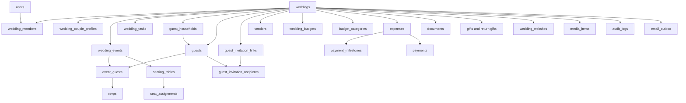

# Make My Marriage — PostgreSQL Database Design

**Status:** MVP logical schema design  
**Version:** 1.0  
**Last consolidated:** 2026-10-10  
**Database:** PostgreSQL  
**Migrations:** Flyway  
**Persistence:** Spring Data JPA/Hibernate (`ddl-auto=validate`)  
**Tenant boundary:** Wedding (`wedding_id`)

> This is the normalized database blueprint and constraints catalog. It is **not** a full executable Flyway DDL script; individual migrations should be generated and integration-tested from these specifications.

## 1. Design rules

1. PostgreSQL is the canonical durable data store; Redis is auxiliary only.
2. Application-generated UUIDv7 IDs (`UUID`) for major entities. Do not depend on DB-version-specific UUIDv7 functions.
3. Money is `NUMERIC(14,2)` (or deliberate higher precision), Java `BigDecimal`, and API decimal string values.
4. `TIMESTAMPTZ` for timestamps; `DATE` for date-only values; event IANA timezone is stored explicitly.
5. Prefer explicit foreign keys and relational joins; website theme/layout config may use `JSONB`.
6. Include `wedding_id` in wedding-scoped business tables; enforce same-wedding references through composites or equivalent transactional checks.
7. Most editable domain records have `created_at`, `updated_at`, `deleted_at`, `deleted_by` and optional `version BIGINT NOT NULL DEFAULT 0`.
8. Use partial unique indexes for uniqueness among *active* soft-deleted rows.
9. Do not aggressively `ON DELETE CASCADE` payment/audit/invitation history; retention is an explicit policy.
10. Build schema through append-only Flyway migrations. Never allow Hibernate to generate production schema.

## 2. Conceptual ERD



## 3. Standard schema conventions

Illustrative common columns:

```sql
id          UUID PRIMARY KEY,
created_at  TIMESTAMPTZ NOT NULL DEFAULT now(),
created_by  UUID NULL REFERENCES users(id),
updated_at  TIMESTAMPTZ NOT NULL DEFAULT now(),
updated_by  UUID NULL REFERENCES users(id),
deleted_at  TIMESTAMPTZ NULL,
deleted_by  UUID NULL REFERENCES users(id),
version     BIGINT NOT NULL DEFAULT 0
```

- Only add fields that suit the table. Audit logs, join tables and consumed tokens differ.
- Keep table and column names `snake_case`; foreign keys use conventional `_id` suffixes.
- Check constraints enforce allowed statuses where suitable, or use PostgreSQL enums deliberately; avoid silently accepting arbitrary strings.
- Partial indexes must align with normal query filters (`deleted_at IS NULL`).
- Protect same-wedding references with patterns such as `UNIQUE (wedding_id,id)` on parents plus `FOREIGN KEY (wedding_id,event_id) REFERENCES wedding_events(wedding_id,id)` in children. Do not substitute a separate loose `wedding_id` column without enforcement.

## 4. Table catalog — Identity and security

### `users`

| Column | Type | Notes |
|---|---|---|
| `id` | UUID PK | UUIDv7 |
| `email` | VARCHAR(320) NOT NULL | Case-insensitive unique, normalized |
| `password_hash` | VARCHAR(255) NOT NULL | Adaptive password hash |
| `display_name` | VARCHAR(150) NOT NULL | User-facing name |
| `phone` | VARCHAR(30) NULL | Optional |
| `status` | VARCHAR(30) NOT NULL | `ACTIVE`, `SUSPENDED`, `DEACTIVATED` |
| `email_verified_at` | TIMESTAMPTZ NULL | Account verification |
| `created_at`, `updated_at`, `version` | Standard | User account metadata |

```sql
CREATE UNIQUE INDEX ux_users_email_ci ON users (lower(email));
```

### `password_reset_tokens`, `email_verification_tokens`

Each has `id UUID PK`, `user_id UUID FK`, unique `token_hash`, `expires_at`, used/verified timestamp and `created_at`. These token records store only hashes. Sensitive delivery material may be encrypted temporarily in `email_outbox`, with its key outside PostgreSQL, then purged after delivery or expiry. Token lifecycle and expiry are validated by backend. Consider storing a keyed HMAC instead of plain SHA-256 if token entropy or database-compromise model warrants it.

### Planner sessions

Spring Session stores planner sessions in **Redis**, not a PostgreSQL business-data table. The browser uses an opaque HttpOnly session cookie with CSRF protection. Logout invalidates the server session; expiry and account-security invalidation rules must be specified before account implementation. There are no planner access/refresh JWTs or refresh-family tables. See [ADR-007](adr/ADR-007-redis-sessions.md).

## 5. Table catalog — Wedding and members

### `weddings`

`id PK`, `name VARCHAR(200)`, `primary_wedding_date DATE`, `timezone VARCHAR(100)` (e.g. `Asia/Kolkata`), `primary_location VARCHAR(300)`, `description TEXT`, `status VARCHAR(30)` (`PLANNING`, `ONGOING`, `COMPLETED`, `ARCHIVED`), `created_by_user_id UUID FK users`, `completed_at`, `archived_at`, standard timestamps/soft deletion/version.

**Important:** `created_by_user_id` records creator; it does not grant `OWNER` by itself.

### `wedding_couple_profiles`

`id PK`, `wedding_id FK`, `couple_role VARCHAR(20)` (`BRIDE`, `GROOM`), `display_name VARCHAR(150)`, timestamps, optional `linked_user_id UUID FK users` **only if** project elects to store a convenience association. Ownership remains authoritative in `wedding_members`.

Unique key: `UNIQUE(wedding_id,couple_role)`.

Creation inserts two profiles, even if no owner has an account yet. Wedding creation, both profiles, and the creator's owner/admin membership commit together in one PostgreSQL transaction inside the `wedding` module; see [ADR-014](adr/ADR-014-wedding-membership.md).

### `wedding_members`

`id PK`, `wedding_id FK`, `user_id FK`, `member_role VARCHAR(30) NOT NULL` (`OWNER`, `ADMIN`, `FAMILY_MEMBER`, `COLLABORATOR`), `couple_role VARCHAR(20) NULL`, `relationship_label VARCHAR(100)`, `status` (`ACTIVE`, `SUSPENDED`, `LEFT`), `invited_by_user_id`, `joined_at`, audit columns and version.

Constraints:

```sql
CHECK (
  (member_role = 'OWNER' AND couple_role IS NOT NULL AND couple_role IN ('BRIDE','GROOM'))
  OR (member_role <> 'OWNER' AND couple_role IS NULL)
)
```

```sql
CREATE UNIQUE INDEX ux_active_member_user
  ON wedding_members(wedding_id,user_id)
  WHERE deleted_at IS NULL;

CREATE UNIQUE INDEX ux_active_owner_slot
  ON wedding_members(wedding_id,couple_role)
  WHERE member_role='OWNER' AND status='ACTIVE' AND deleted_at IS NULL;
```

The explicit null check matters because a SQL `CHECK` also permits an unknown/null result. Suspended or inactive owner transitions still need an explicit security policy: the illustrative active-owner index alone does not reserve a suspended owner's slot. Resolve slot protection and recovery before implementing those transitions. Do **not** silently treat a suspended owner as a free slot.

### `permission_definitions`

`code VARCHAR(100) PRIMARY KEY`, `description VARCHAR(255)`. Seed capability codes, e.g. `MANAGE_EVENTS`, `MANAGE_TASKS`, `VIEW_GUESTS`, `MANAGE_GUESTS`, `VIEW_FINANCE`, `MANAGE_FINANCE`, `MANAGE_VENDORS`, `MANAGE_INVITATIONS`, `MANAGE_SEATING`, `MANAGE_GIFTS`, `MANAGE_DOCUMENTS`, `MANAGE_WEBSITE`, `MANAGE_MEMBERS`.

### `role_permissions`

`role_code VARCHAR(30)`, `permission_code VARCHAR(100) FK`, composite PK `(role_code,permission_code)`. Versioned via Flyway seed migrations when defaults change.

### `member_permission_overrides`

`member_id UUID FK wedding_members`, `permission_code VARCHAR(100) FK`, `effect VARCHAR(10)` (`ALLOW`,`DENY`), PK `(member_id,permission_code)`.

Owners retain protected capabilities independent of ordinary override evaluation. Document precedence/deny behavior before coding.

### `member_invitations`

`id PK`, `wedding_id FK`, `email VARCHAR(320)`, `target_role VARCHAR(30)`, `couple_role VARCHAR(20) NULL`, unique `token_hash`, `status` (`PENDING`, `ACCEPTED`, `EXPIRED`, `CANCELLED`), `expires_at`, `invited_by_user_id FK users`, `accepted_by_user_id FK users NULL`, `accepted_at`, timestamps.

- `OWNER` invitation requires BRIDE or GROOM and a vacancy/appropriate recovery policy.
- Avoid two outstanding active owner invitations claiming the same role without explicit invalidation policy.
- Secure account/email verification and invitation redemption happen in one transaction.

## 6. Table catalog — Planning

### `wedding_events`

`id PK`, `wedding_id FK`, `name VARCHAR(200)`, `description TEXT`, `starts_at TIMESTAMPTZ`, `ends_at TIMESTAMPTZ NULL`, `timezone VARCHAR(100)`, `venue_name VARCHAR(200)`, `venue_address TEXT`, `dress_code VARCHAR(200)`, `status VARCHAR(30)` (`UPCOMING`,`COMPLETED`,`CANCELLED`), `publish_on_website BOOLEAN DEFAULT FALSE`, `sort_order INTEGER`, audit/soft deletion/version.

**Checks:** end time after or equal start; event belongs to exactly one wedding. Storing a public flag on an event does not override invitation-only restrictions: public presentation still filters explicitly.

### `wedding_tasks`

`id PK`, `wedding_id FK`, `event_id UUID NULL`, `title VARCHAR(250)`, `description`, `status` (`TODO`,`IN_PROGRESS`,`BLOCKED`,`COMPLETED`), `priority` (`LOW`,`MEDIUM`,`HIGH`), `due_at TIMESTAMPTZ NULL`, `visibility` (`ALL_MEMBERS`,`SELECTED_MEMBERS`), `completed_at`, audit/soft deletion/version.

`event_id` must reference an event in the same wedding.

### `task_assignees`

PK `(task_id,member_id)`. Add wedding-scoping constraint or transactional validation ensuring both rows belong to the same wedding. Multiple assignees are supported in the database even if the first UI limits the count.

### `task_visible_members`

PK `(task_id,member_id)`; used when `visibility=SELECTED_MEMBERS`. Define whether creator and owners always have access, and enforce consistently in list endpoints, aggregates and audit views.

## 7. Table catalog — Guests, events and RSVP

### `guest_households`

`id PK`, `wedding_id FK`, `name VARCHAR(200)`, `side VARCHAR(20)` (`BRIDE`,`GROOM`,`MUTUAL`), `notes`, timestamps, soft delete and version.

### `guests`

`id PK`, `wedding_id FK`, `household_id UUID NULL`, `full_name VARCHAR(200)`, optional `email VARCHAR(320)` and `phone VARCHAR(30)`, `side VARCHAR(20)`, `relationship VARCHAR(100)`, `notes`, audit/soft deletion/version.

No uniqueness constraint on email or phone: families share numbers/emails and some guests have no contact detail. A guest's household must be from the same wedding.

### `event_guests`

`id PK`, `wedding_id FK`, `event_id UUID FK`, `guest_id UUID FK`, `invited_at TIMESTAMPTZ NULL`, timestamps/soft delete. Both guest and event must belong to `wedding_id`.

```sql
CREATE UNIQUE INDEX ux_active_event_guest
  ON event_guests(event_id, guest_id)
  WHERE deleted_at IS NULL;
```

### `rsvps`

`id PK`, `wedding_id FK`, `event_guest_id UUID FK`, `status VARCHAR(30)` (`ATTENDING`,`NOT_ATTENDING`,`MAYBE`), `message`, `responded_at`, timestamps, `version`. Unique active/current RSVP per `event_guest_id`; **missing row means `NO_RESPONSE`**.

If historical changes matter, introduce `rsvp_history` or append audit events; do not create multiple ambiguous current RSVP rows.

### `guest_invitation_links`

`id PK`, `wedding_id FK`, unique `token_hash`, `status` (`ACTIVE`,`REVOKED`,`EXPIRED`), optional `expires_at`, `created_by_user_id`, `created_at`, `revoked_at`.

One link may represent one person, a whole household, or a selected subset; authorization is determined by explicit recipients, never by guessing from a household ID alone.

### `guest_invitation_recipients`

Composite PK `(invitation_id,guest_id)`, both FK-backed and same-wedding checked. Invitation grants access only to events actually assigned to its listed guests. If event eligibility must be frozen at send time, add a scoped `invitation_event_guests` association and update token exchange to check it.

## 8. Table catalog — Vendors and finance

### `vendors`

`id PK`, `wedding_id FK`, `name`, `category`, `contact_person`, `phone`, `email`, `quoted_amount NUMERIC(14,2)`, `agreed_amount NUMERIC(14,2)`, `currency CHAR(3) DEFAULT 'INR'`, `notes`, standard metadata.

### `vendor_events`

PK `(vendor_id,event_id)`; both sides wedding-scoped.

### `wedding_budgets`

`id PK`, `wedding_id FK UNIQUE`, `total_amount NUMERIC(14,2)`, `currency CHAR(3) DEFAULT 'INR'`, `notes`, timestamps/version. One overall current budget per wedding.

### `budget_categories`

`id PK`, `wedding_id FK`, `name VARCHAR(150)`, `planned_amount NUMERIC(14,2) NULL`, `sort_order`, timestamps/soft deletion. Categories such as Photography, Venue, Catering, Decoration, Clothing and Jewellery are default templates, not a rigid enum.

### `expenses`

`id PK`, `wedding_id FK`, optional `event_id`, `vendor_id`, `category_id` (all same wedding), `name VARCHAR(250)`, `description`, `total_amount NUMERIC(14,2)`, `currency CHAR(3)`, `expense_date DATE`, `notes`, standard audit/soft deletion/version.

Do **not** store authoritative `paid_amount` here: derived paid = sum(active payments).

### `payment_milestones`

`id PK`, `wedding_id FK`, `expense_id FK`, `name VARCHAR(150)`, `amount_due NUMERIC(14,2)`, `due_date DATE`, `notes`, audit/soft deletion/version.

Milestone example: Deposit 30,000; Second payment 70,000; Final 50,000. These are obligations, **not actual payments**.

### `payments`

`id PK`, `wedding_id FK`, `expense_id FK`, nullable `payment_milestone_id FK`, `amount NUMERIC(14,2)`, `currency CHAR(3)`, `paid_at TIMESTAMPTZ`, `payment_method VARCHAR(50)`, `reference VARCHAR(200)`, `notes`, `recorded_by UUID FK users`, audit/soft deletion/version.

Milestone, expense and wedding must be consistent. Positive amount required for standard payments. Define refund/void representation before allowing negative values.

**Derived financial calculations:**

```text
expense_paid           = SUM(active payments.amount for expense)
expense_outstanding    = expense.total_amount - expense_paid
wedding_committed      = SUM(active expenses.total_amount)
wedding_paid           = SUM(active payments.amount)
wedding_budget_left    = wedding_budgets.total_amount - wedding_committed
```

`UNPAID` = no payments; `PARTIALLY_PAID` = positive payments below expense total; `PAID` = payment total >= expense total. Overpayment must be explicitly handled and flagged.

### `idempotency_records` (recommended persistent or Redis-atomic)

A payment request's `Idempotency-Key` must survive retries and concurrent requests reliably. Suggested fields if using PostgreSQL: `(scope, key, request_hash, response_snapshot, status, expires_at)`, unique `(scope,key)`. Redis-only idempotency is acceptable for transient operations if its loss semantics are explicitly acceptable; **financial commands need carefully considered durability**.

## 9. Table catalog — Documents and media

### `documents`

`id PK`, `wedding_id FK`, `file_name VARCHAR(500)`, `storage_key VARCHAR(1000)` unique in provider scope, `content_type VARCHAR(150)`, `size_bytes BIGINT`, optional `sha256_hash VARCHAR(64)`, `uploaded_by UUID FK users`, `created_at`, `deleted_at`, `deleted_by`.

### Document association tables

Use explicit FK-backed joins rather than `(entity_type,entity_id)` pairs without FK enforcement:

- `task_documents(task_id, document_id)`.
- `vendor_documents(vendor_id, document_id)`.
- `expense_documents(expense_id, document_id)`.
- `event_documents(event_id, document_id)`.

Enforce matching wedding across each link. Add a `document_upload_requests` temporary metadata record if needed to validate signed upload confirmation.

### `media_items`

`id PK`, `wedding_id FK`, optional `event_id FK`, `storage_key`, `file_name`, `content_type`, `size_bytes`, `width`, `height`, `visibility` (`PRIVATE`,`WEBSITE`), `sort_order`, `uploaded_by`, timestamps/soft delete.

Never assume upload means public visibility.

### `event_livestreams`

`id PK`, `event_id FK`, `url TEXT`, `platform VARCHAR(50)`, `enabled BOOLEAN`, timestamps. External URL only; no video blobs.

## 10. Table catalog — Gifts and seating

### `gifts`

`id PK`, `wedding_id FK`, optional `guest_id` and `event_id`, `gift_type` (`CASH`,`PHYSICAL`,`OTHER`), `description`, `cash_amount NUMERIC(14,2) NULL`, optional `currency CHAR(3)`, `received_by_member_id`, `notes`, timestamps/soft delete.

### `return_gift_items`

`id PK`, `wedding_id FK`, `name`, `quantity_purchased INTEGER >= 0`, `notes`, timestamps/soft deletion.

### `return_gift_distributions`

`id PK`, `return_gift_item_id FK`, optional `guest_id` or `household_id`, `quantity INTEGER > 0`, `distributed_at`, `distributed_by UUID FK wedding_members`, `created_at`. Check that exactly one recipient mode is specified if required by product UX. Remaining = purchased − active distributed quantity.

### `seating_tables`

`id PK`, `wedding_id FK`, `event_id FK`, `name VARCHAR(100)`, `capacity INTEGER > 0`, `notes`, timestamps/soft deletion/version.

### `seat_assignments`

`id PK`, `wedding_id FK`, `event_id FK`, `seating_table_id FK`, `guest_id FK`, optional `seat_label`, timestamps. A guest may have **at most one assignment per event**. Each assigned guest must be invited to the same event and the table must belong to it. Check capacity in a transaction with appropriate locking to avoid concurrent overbooking.

```sql
CREATE UNIQUE INDEX ux_active_seat_by_event_guest
  ON seat_assignments(event_id,guest_id);
```

If soft deletion is added to seat assignments, change uniqueness to a partial active-row index.

## 11. Table catalog — Website, notifications, audit

### `wedding_websites`

`id PK`, `wedding_id FK UNIQUE`, `slug VARCHAR(150)` case-insensitive unique, `visibility` (`PUBLIC`,`UNLISTED`), `published BOOLEAN`, `headline VARCHAR(250)`, `couple_message TEXT`, `theme_config JSONB`, `layout_config JSONB`, `published_at`, timestamps/version.

```sql
CREATE UNIQUE INDEX ux_wedding_website_slug_ci
  ON wedding_websites(lower(slug));
```

Public reads must filter to published/allowed content and prevent unintended indexing for unlisted sites where policy requires it.

### `email_outbox`

`id PK`, optional `wedding_id FK`, `recipient_email`, `template_code`, `payload JSONB` (non-secret template data), `status` (`PENDING`,`PROCESSING`,`SENT`,`FAILED`), `attempt_count`, `next_attempt_at`, `provider_message_id`, `last_error` (redacted), `created_at`, `sent_at`.

**Accepted:** this table is the sole durable email work source; do not add a duplicate Spring Modulith persistent publication pipeline. Registration must insert its user, verification-token record, and outbox entry atomically. See [ADR-009](adr/ADR-009-email-outbox.md).

Refine the schema with worker-claim/lease metadata, stable delivery/deduplication identity, encrypted sensitive payload and key-version metadata, and expiry/purge support when implementing the account milestone. Keep encryption keys outside PostgreSQL. Do not place raw tokens in ordinary JSON payloads, logs, or audit records. The worker sends outside database transactions, safely reclaims expired work, retries with bounded exponential backoff, and records provider results. At-least-once delivery may produce duplicates after a crash; it is not an exactly-once guarantee.

### `audit_logs`

Append-only `id PK`, `wedding_id`, `actor_type` (`USER`,`GUEST`,`SYSTEM`), `actor_user_id`, `actor_guest_id`, `action`, `entity_type`, `entity_id`, redacted `metadata JSONB`, optional `ip_address` and `user_agent`, `created_at`.

Examples: `OWNER_JOINED`, `PERMISSION_CHANGED`, `RSVP_UPDATED`, `PAYMENT_RECORDED`, `DOCUMENT_DELETED`, `EXPENSE_UPDATED`. Never store raw tokens/passwords/secrets here; audit retention and personal-data erasure require an explicit policy.

## 12. Indexing plan

```sql
-- Membership and ownership
CREATE INDEX ix_members_user ON wedding_members(user_id);
CREATE INDEX ix_members_wedding ON wedding_members(wedding_id);

-- Planner reads
CREATE INDEX ix_events_by_wedding_start
  ON wedding_events(wedding_id, starts_at) WHERE deleted_at IS NULL;
CREATE INDEX ix_tasks_by_wedding_status_due
  ON wedding_tasks(wedding_id,status,due_at) WHERE deleted_at IS NULL;

-- Guest/RSVP reads
CREATE INDEX ix_guests_by_wedding
  ON guests(wedding_id) WHERE deleted_at IS NULL;
CREATE INDEX ix_event_guests_by_event ON event_guests(event_id);
CREATE INDEX ix_event_guests_by_guest ON event_guests(guest_id);

-- Financial reporting
CREATE INDEX ix_expenses_by_wedding_category
  ON expenses(wedding_id,category_id) WHERE deleted_at IS NULL;
CREATE INDEX ix_payments_by_expense ON payments(expense_id);

-- Security and history
CREATE INDEX ix_member_invitation_wedding_status
  ON member_invitations(wedding_id,status);
CREATE INDEX ix_audit_wedding_created
  ON audit_logs(wedding_id,created_at DESC);
CREATE INDEX ix_email_due
  ON email_outbox(status,next_attempt_at)
  WHERE status IN ('PENDING','FAILED');
```

PostgreSQL `pg_trgm` and/or full-text indexes can support `q` search on guest names/vendors/tasks later. Validate with representative query plans before adding speculative indexes.

## 13. Flyway migration order

```text
backend/src/main/resources/db/migration/
V001__create_users.sql
V002__create_auth_tokens.sql
V003__create_weddings.sql
V004__create_couple_profiles.sql
V005__create_wedding_members.sql
V006__create_permissions.sql
V007__seed_permissions.sql
V008__create_member_invitations.sql
V009__create_wedding_events.sql
V010__create_tasks.sql
V011__create_guest_households.sql
V012__create_guests.sql
V013__create_event_guests.sql
V014__create_rsvps.sql
V015__create_guest_invitations.sql
V016__create_vendors.sql
V017__create_budget_tables.sql
V018__create_expenses.sql
V019__create_payment_tables.sql
V020__create_documents.sql
V021__create_document_links.sql
V022__create_gifts.sql
V023__create_seating.sql
V024__create_wedding_website.sql
V025__create_media.sql
V026__create_livestream.sql
V027__create_email_outbox.sql
V028__create_audit_log.sql
V029__create_indexes.sql
```

These are **illustrative** names/order, not migrations to generate during Milestone 0. Add schema changes with each implemented feature and number them in that actual order. Account verification needs its outbox before wedding features; introduce any optional wedding association only when its referenced table exists. Audit tables likewise arrive with the first audited feature. Once migrations are shared, append new versions rather than renumbering or editing them.

Example application config:

```properties
spring.flyway.enabled=true
spring.jpa.hibernate.ddl-auto=validate
```

Use Testcontainers to run all migrations on an empty database in CI, including rollback/failure tests where necessary. Shared migrations must be immutable.

## 14. Queries needed by MVP

### Confirmed attendees without seating

```sql
SELECT g.id, g.full_name
FROM guests g
JOIN event_guests eg
  ON eg.guest_id=g.id AND eg.wedding_id=g.wedding_id
JOIN rsvps r ON r.event_guest_id=eg.id
LEFT JOIN seat_assignments sa
  ON sa.guest_id=g.id AND sa.event_id=eg.event_id
WHERE eg.wedding_id=:wedding_id
  AND eg.event_id=:event_id
  AND eg.deleted_at IS NULL AND g.deleted_at IS NULL
  AND r.status='ATTENDING'
  AND sa.id IS NULL;
```

### Expense paid totals

```sql
SELECT e.id, e.name, e.total_amount,
       COALESCE(SUM(p.amount) FILTER (WHERE p.deleted_at IS NULL),0) AS paid_amount
FROM expenses e
LEFT JOIN payments p ON p.expense_id=e.id AND p.wedding_id=e.wedding_id
WHERE e.wedding_id=:wedding_id AND e.deleted_at IS NULL
GROUP BY e.id,e.name,e.total_amount;
```

### Guest RSVP summary

- Start from **active** `event_guests` for a target wedding/event.
- Left join current `rsvps`.
- Count missing RSVP as `NO_RESPONSE`.
- Be explicit about whether dashboard statistics count unique guests or event invitations across multiple events; these produce different totals.

## 15. Deletion, privacy and lifecycle

- Use soft deletion for wedding/task/guest/vendor/expense/document/media records where restoration and references matter.
- Avoid deleting payment and audit history without a deliberate correction/retention policy.
- Standard APIs hide deleted business entities.
- Database FK restrictions and application validation prevent orphaned associations.
- Consent, privacy/retention requests and legal erasure may require anonymization or selective hard deletion despite the soft-delete model.

## 16. Verification checklist

- [ ] Wedding creator is not implicitly owner.
- [ ] One current bride/groom owner slot per wedding; concurrent invites/claims handled.
- [ ] Active membership unique per user per wedding.
- [ ] All multi-entity relations are wedding-consistent.
- [ ] Guest event invitation determines RSVP access.
- [ ] Financial sums come from payment rows; mutation audited.
- [ ] Seating assignments reject cross-event and over-capacity operations.
- [ ] Token tables are hash-only; temporary sensitive outbox delivery material is encrypted and purged after delivery or expiry, with no raw tokens in logs or audit.
- [ ] Soft-delete uniqueness, indexes and normal filters match.
- [ ] Flyway works from a clean DB and Hibernate validates.
- [ ] No cross-tenant access in repository/API integration tests.

## 17. Open schema details

- Ownership recovery and suspended-owner slot semantics.
- RSVP change history and event cutoff.
- Whether invitation event eligibility is live or frozen at issue time.
- Durable idempotency design for payments.
- Refund/overpayment and negative adjustment records.
- File upload staging records and retention.
- Audit log personal-data redaction and archival retention.

---

**Related documentation:** [Product Requirements](01-product-requirements.md) · [System Architecture](02-system-architecture.md) · [REST API Design](04-api-design.md)
